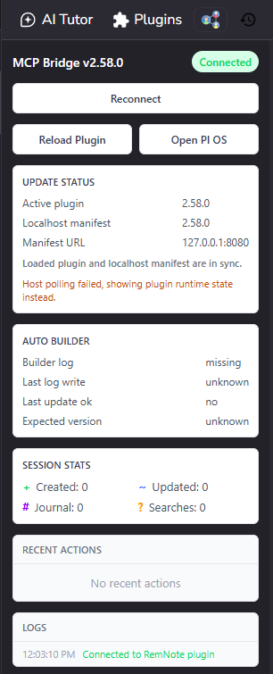

# RemNote MCP Bridge (Y Edition)

Current release target: **v2.59.41** (source target; verify `get_status` for the loaded version).

## 2.59.41 safety and lifecycle contract

- Generic `rem_sdk_call` / `rem_raw_call` are read-only. Mutations use typed,
  guarded actions. `delete_note` needs `confirm: DELETE_NOTE`, `allowDestructive: true`,
  and `expectedRemId` matching `remId`. `overwrite_note_content` uses the same fields
  with `confirm: OVERWRITE_NOTE_CONTENT` and explicit string `content`.
- Existing-note destructive `upsert_structured_note` requires exact title/parent,
  `confirm: UPSERT_STRUCTURED_NOTE`, `allowDestructive: true`, and `expectedRemId`.
  Empty replacements require `allowEmpty: true`. Preview is not a completed write.
- Replacement rows/images are prepared before removing old direct children.
  SDK writes are not transactional: a partial new structure may remain after a
  failure. Reconcile the returned target before retrying; never auto-replay writes.
- Bridge calls are source-socket-owned. Disconnects/timeouts return an unknown
  outcome; JSON pong freshness drives connection health and owned socket recovery.
- HTTP/WS accept exact local plugin origins plus `app://js`; foreign and opaque
  browser origins are rejected. This protects browser requests, not against other
  trusted local processes. The host remains loopback-only.
- Runtime status writes are serialized; failed status writes retry on the next
  heartbeat without retrying the note operation.
- `npm run test:unit` selects isolated source/mock and ephemeral-loopback tests.
  `npm run test:ui` is a separate browser-fixture gate, not live RemNote acceptance.

Safety update: ordinary create, rename, heading, highlight, and power-up
operations no longer delete blank children or siblings implicitly. Cleanup
must use an explicitly reviewed Doctor/Safe Migration plan. Editor `setText`
requires a readable single Text selection and can additionally check
`expectedRemId`; SDK completion is not persistence verification. Prefer
`update_note(remId)` for a targeted rename. Validated text ranges use safe,
nonnegative integer offsets with `start <= end`.

The earlier 265-bullet deletion dialog was cancelled. Its origin is still
unknown; the safety fixes must not be described as proving that root cause.

Current local dev note: v2.59.0 adds the read-only RemNote rontgen diagnostic
action. It combines bridge health, local host checks, RemNote process/CDP
targets, live DOM samples, optional console capture, optional screenshot
capture, DB inventory, and SDK surface summary without changing RemNote data or
plugin enable state. `verify_remnote_rontgen.ps1` turns that evidence into a
read-only PASS/FAIL acceptance gate for local debugging.

This plugin connects RemNote to AI assistants through a local bridge. In plain
English: it lets an AI help you find notes, organize your knowledge base, create
or update notes, inspect tags and properties, export your RemNote data for
analysis, and plan safer cleanups before changing anything.

It is built for people who want RemNote to work with tools like Claude, GPT, or
other MCP clients without manually copying notes back and forth.

## What You Can Do With It

- Ask an AI to search your RemNote notes and open the right page.
- Create, update, move, tag, and organize notes from an AI workflow.
- Export parts of your knowledge base for backup, review, or graph analysis.
- Find messy areas such as missing dates, broken properties, or tag/template
  issues before they turn into a bigger cleanup job.
- Make safer bulk changes with dry-run previews, confirmations, snapshots, and
  rollback-oriented checks.

The bridge runs locally on your computer. It does not upload your whole
knowledge base to a third-party service by itself, and direct internal database
access is kept read-only for diagnostics.

## Sidebar Preview

This is the right sidebar panel you should see when the plugin and local bridge
are connected:



What the panel shows:

- **Connected badge**: RemNote and the local bridge can see each other. This is
  the first thing to check if your AI app cannot use RemNote.
- **Reconnect**: asks the RemNote plugin to reconnect to the local bridge.
  Click this after restarting the bridge or if your AI app stops seeing RemNote.
- **Reload Plugin**: reloads the installed plugin bundle. This is useful after
  updating the plugin or testing a new local build.
- **Open PIOS**: opens the configured main workspace/page for this fork. If you
  do not use that workflow, you can ignore this button.
- **Update Status**: compares the plugin currently loaded in RemNote with the
  local manifest version. Matching versions mean RemNote is running the build
  you expect.
- **Auto Builder**: a developer helper for local builds. Normal marketplace
  users usually do not need this section.
- **Session Stats**: counts what happened during this bridge session, such as
  created notes, updated notes, journal entries, and searches.
- **Recent Actions**: shows the latest AI-triggered bridge actions.
- **Logs**: shows connection messages and short status notes.

If you see an orange or red diagnostic line, read it as a troubleshooting hint.
For example, the panel may temporarily fall back to plugin runtime status if it
cannot poll the local host directly. If the **Connected** badge is green and
your AI tool works, the bridge is still usable.

## How To Connect Your AI Assistant

If you are new to MCP, think of the setup like a short chain:

```text
RemNote plugin -> local bridge on your computer -> MCP server -> your AI app
```

The RemNote plugin is the RemNote side of the connection. Your AI assistant also
needs an MCP-compatible app or client that can start a local MCP server.

Beginner setup:

1. Install and enable this plugin in RemNote.
2. Keep RemNote open while you use the AI connection.
3. Start the local bridge on your computer. In this repo, the bridge host is
   `bridge-host.cjs`; it listens on `http://127.0.0.1:3400` and the RemNote
   plugin connects back to it over `ws://127.0.0.1:3401`.
4. Check the bridge health page. If `http://127.0.0.1:3400/health` says
   `pluginConnected: true`, RemNote and the local bridge can see each other.
5. In your AI app's MCP settings, add a local MCP server that forwards requests
   to `http://127.0.0.1:3400`.

Most MCP-compatible AI apps use a config that looks roughly like this:

```json
{
  "mcpServers": {
    "remnote": {
      "command": "node",
      "args": ["C:/path/to/your/remnote-mcp-server/index.js"],
      "env": {
        "ANTIGRAVITY_REMNOTE_HOST_URL": "http://127.0.0.1:3400"
      }
    }
  }
}
```

Exact menus, file paths, and environment variable names depend on the MCP server
you use. The important idea is simple: the AI starts a small MCP server, that
server talks to the local RemNote bridge, and the bridge talks to the RemNote
plugin. After setup, try asking your AI: "check my RemNote connection", "search
my RemNote for X", or "create a note in RemNote about Y".

If RemNote is closed, the plugin is disabled, or the local bridge is not running,
your AI will not be able to read or update RemNote.

This is a production-oriented fork of
[`quentintou/remnote-mcp-bridge`](https://github.com/quentintou/remnote-mcp-bridge)
with a much larger typed action surface for reading, writing, debugging,
exporting, and safely migrating a RemNote knowledge base.

## Public Status

The RemNote marketplace listing may still show the older **v1.1.4** text until
the marketplace package is republished. The local development source in this
branch is currently the **v2.59.41** line.

Important IDs:

- Marketplace plugin ID: `remnote-mcp-bridge-y-edition-dev` (the approved listing owned by this fork; `remnote-mcp-bridge-y-edition` is a different, rejected listing and must not be used)
- Local development plugin ID: `remnote-mcp-bridge-y-edition-dev-2`
- Local manifest URL: `http://localhost:8080/manifest.json`
- Local bridge HTTP: `http://127.0.0.1:3400`
- Local bridge WebSocket: `ws://127.0.0.1:3401`

Use `public/manifest.marketplace.json` when preparing a marketplace package for
the existing public plugin ID. The default `public/manifest.json` remains the
local development manifest so it does not collide with the marketplace install
inside the same RemNote profile.

The marketplace package also includes `public/logo.png` (RemNote reads `<plugin base>/logo.png` for the plugin icon) and `public/logo.svg`, so the published plugin
uses a custom bridge mark instead of the SDK's autogenerated placeholder logo.

Marketplace update note: RemNote's **Build -> Upload plugin** button currently
behaves like a new-plugin submission path. If it returns
`A plugin with ID remnote-mcp-bridge-y-edition-dev already exists`, do **not** choose
a new ID. That would create a separate marketplace entry instead of updating the
existing one. Keep the stable ID and use the existing listing's owner/manage
update path if RemNote exposes one, or send the prepared package/repo to RemNote
review/support for the existing plugin ID.

## Sections (unified plugin, 2.61.0)

Earlier separate local plugins are now optional sections, each with its own on/off setting (`feature.<id>`).
The MCP bridge is on by default; every other section is off until you enable it.

| Section | Setting | Mobile |
|---|---|---|
| MCP Bridge | `feature.kopru` (on) | not started on mobile |
| Translation & AI Assistant | `feature.ceviri` | not started on mobile |
| Learn (vocabulary lessons) | `feature.ogren` | works; image/story hints desktop only |
| Eisenhower board | `feature.eisenhower` | works |
| Todo Alarm | `feature.alarm` | not started on mobile; needs local 8084 service |
| PDF Reading View | `feature.pdfdark` | works |
| MyDrive | `feature.mydrive` | not started on mobile; needs local 8083 server |
| No Bullet editor mode | `feature.nobullet` | works |

## What Changed Since v1.1.4

The old marketplace page described a small fork with roughly 19 bridge actions.
The current bridge exposes **152 covered actions** with typed payloads, structured
results, and smoke coverage.

Major additions:

- Full SDK-visible vault read/export layer:
  `get_all_rems`, `read_rem_full`, `export_vault_snapshot`,
  `host_remnote_vault_snapshot_export`, partitioned JSONL exports, query,
  stats, schema profile, field profile, quality report, diff, and graph export.
- Safe RemNote editing workflows for notes, tags, properties, templates,
  tables, folders/documents, portals, sources, references, aliases, flashcards,
  and practice metadata.
- Confirmation-gated control actions for higher-risk surfaces:
  app, window, editor, queue, plugin runtime, events, reader, scheduler,
  card mutation, RemObject state, and RemObject structure.
- Read-only forensic/debug tools for RemNote IndexedDB and host-side LevelDB
  snapshots. These do not write to RemNote internal database files.
- Read-only RemNote rontgen diagnostics through
  `host_remnote_rontgen_snapshot`, `diagnose_remnote_rontgen.ps1`, and
  `verify_remnote_rontgen.ps1`, useful for UI/runtime/console/localhost/process
  triage and deterministic PASS/FAIL checks.
- Capability inspection and SDK gap reporting so agents can see what is
  supported, partially supported, blocked by SDK, UI-only, or unsafe for direct
  DB writes.
- RemNote Doctor, Learning Inbox, Safe Migration Engine, rollback validation,
  audit log, and dry-run repair planning.
- RichText tools for Markdown parsing, format inspection, range formatting, and
  confirmation-gated HTML import.
- Local host stack that keeps the bridge alive independently of the sidebar
  widget and exposes health/status endpoints.

## Capability Map

### Read and Export

- `get_all_rems`
- `read_rem_full`
- `export_subtree`
- `export_tag_view`
- `export_daily_range`
- `export_graph_edges`
- `export_vault_snapshot`
- `host_remnote_vault_snapshot_export`
- `host_remnote_vault_snapshot_export_partitioned`
- `host_remnote_vault_export_query`
- `host_remnote_vault_export_stats`
- `host_remnote_vault_export_stats_aggregate`
- `host_remnote_vault_export_schema_profile`
- `host_remnote_vault_export_field_profile`
- `host_remnote_vault_quality_report`
- `host_remnote_vault_export_graph`
- `host_remnote_vault_export_graph_file`
- `host_remnote_vault_export_diff`

### Notes, Tags, Tables, and Properties

- `create_note`, `read_note`, `update_note`, `delete_note`
- `move_note`, `overwrite_note_content`, `list_children`, `open_note`
- `create_table`, `discover_tables`, `list_table_rows`, `set_table_filter_raw`
- `create_property`, `get_property_info`, `set_property_type`
- `set_tag_property_value`, `add_tag_by_id`, `remove_tag_by_id`
- `create_template`, `apply_template_to_rem`, `set_template_auto_apply`,
  `apply_tag_auto_template`, `list_tag_templates`

### Graph, References, and Structure

- `create_reference`, `create_portal`, `create_alias`, `create_link_rem`
- `add_source_to_rem`, `remove_source_from_rem`
- `add_rem_to_portal`, `remove_rem_from_portal`
- `inspect_rem_location`, `inspect_rem_relations`,
  `inspect_rem_graph_context`
- `control_rem_structure`

### Flashcards and Practice

- `create_flashcard`, `create_cloze_flashcard`, `batch_create_flashcards`
- `update_flashcard_back`
- `set_practice_state`
- `export_practice_queue`
- `export_card_catalog`
- `read_card_full`
- `control_card`
- `control_practice_queue`

### Runtime, SDK, and Debug

- `get_status`, `reload_plugin`, `capability_inspector`, `sdk_gap_report`
- `host_remnote_rontgen_snapshot`
- `host_remnote_sdk_surface_gap_report`
- `sdk_namespace_call`, `rem_sdk_call`, `rem_raw_call`
- `inspect_app_context`, `inspect_editor_context`,
  `inspect_queue_context`, `inspect_plugin_runtime`,
  `inspect_focus_context`, `inspect_powerup_registry`
- `control_app`, `control_window`, `control_editor`,
  `control_plugin_runtime`, `control_events`, `control_reader`,
  `control_scheduler`
- `indexeddb_inventory`, `indexeddb_read_store`
- `host_remnote_db_inventory`, `host_remnote_db_doctor_scan`,
  `host_remnote_leveldb_snapshot_scan`, `host_remnote_leveldb_decode`,
  `host_remnote_leveldb_log_decode`, `host_remnote_leveldb_entity_index`,
  `host_remnote_leveldb_sdk_map`, `host_remnote_leveldb_graph_export`

## Safety Model

The bridge deliberately separates safe reads from risky writes.

- SDK-visible vault export is the canonical "read the knowledge base" path.
- Internal DB and LevelDB tools are read-only snapshot/forensic tools.
- Direct writes to RemNote internal database files are out of scope.
- Destructive operations require explicit confirmation payloads.
- Merge/structure operations require an additional destructive confirmation.
- Safe Migration actions provide dry-run plans, audit logs, and rollback
  validation before applying large changes.

## Current Validation

Expected current local validation:

```powershell
npm run check-types
npm run build
powershell -NoProfile -ExecutionPolicy Bypass -File .\check_action_coverage.ps1 -FailOnUncovered
powershell -NoProfile -ExecutionPolicy Bypass -File .\test_bridge_actions.ps1
powershell -NoProfile -ExecutionPolicy Bypass -File .\test_readonly_debug_actions.ps1
powershell -NoProfile -ExecutionPolicy Bypass -File .\test_flashcard_actions.ps1
powershell -NoProfile -ExecutionPolicy Bypass -File .\verify_remnote_rontgen.ps1 -CaptureScreenshot
```

Expected coverage:

```text
152 action, 152 covered, 0 uncovered
```

Expected live health:

```text
pluginConnected = true
pluginVersion = 2.59.41
verify_remnote_rontgen.ps1 ok = true
```

## Local Development

```bash
npm install
npm run build
powershell -NoProfile -ExecutionPolicy Bypass -File .\update_remnote_bridge.ps1
```

The local stack uses:

- `bridge-host.cjs` for HTTP `3400` and WebSocket `3401`
- `static-server.cjs` for the built plugin manifest on `8080`
- `ensure_local_plugin.ps1` to start missing local services
- `update_remnote_bridge.ps1` to typecheck/build/reload

Manual health checks:

```powershell
Invoke-RestMethod http://127.0.0.1:3400/health
Invoke-RestMethod http://127.0.0.1:8080/manifest.json
```

The `Cevir > Sohbet` host keeps the last six turns. Short continuation messages
such as `anlat`, `olur`, and `devam et` accept the immediately preceding
assistant offer when that offer is explicit; otherwise they remain questions
about the selected expression. The same resolver is used by the quick and
quality chat lanes.

Image search is sense-aware for ambiguous concepts. In the thinking sense,
`mull` searches for a person pondering or considering a decision and rejects
Isle of Mull, Scotland, panorama, coast, and lighthouse metadata. A candidate
must contain positive sense evidence; when none survives, the host returns no
featured image instead of showing an unrelated one.

## Documentation

- Full old-to-new comparison:
  [`docs/COMPARISON_V1.1.4_TO_V2.58.0.md`](docs/COMPARISON_V1.1.4_TO_V2.58.0.md)
- User-facing release notes:
  [`docs/RELEASE_V2.58.0.md`](docs/RELEASE_V2.58.0.md)
- Legacy v1.1.0 to v1.1.4 comparison:
  [`docs/COMPARISON_V1.1.0_TO_V1.1.4.md`](docs/COMPARISON_V1.1.0_TO_V1.1.4.md)
- Operator notes:
  [`docs/OPERATOR_NOTES.md`](docs/OPERATOR_NOTES.md)
- vNext personal intelligence spec:
  [`docs/VNEXT_PERSONAL_INTELLIGENCE_SPEC.md`](docs/VNEXT_PERSONAL_INTELLIGENCE_SPEC.md)

## Build Output

```bash
npm run build
```

Build output:

- `PluginZip.zip` is produced from the `dist/` folder.
- For marketplace publishing, use:

```powershell
powershell -NoProfile -ExecutionPolicy Bypass -File .\build_marketplace_package.ps1
```

This temporarily swaps in `public/manifest.marketplace.json`, builds the zip,
copies it to `PluginZip_v2.58.0_marketplace.zip`, and restores the local
development manifest and local-dev build. Before uploading, verify the zip still
contains `manifest.json` with ID `remnote-mcp-bridge-y-edition` and `logo.svg`;
uploading a zip built from the local-dev ID would target a separate development
plugin. If RemNote rejects the stable package with "plugin ID already exists",
do not change the ID. Treat that as confirmation that the stable marketplace
entry already exists, then update through the owner/manage/review path for that
same ID.

## License

MIT, same as upstream.

## Credits

- Upstream project: <https://github.com/quentintou/remnote-mcp-bridge>
- Fork maintainer: <https://github.com/riyadist>
